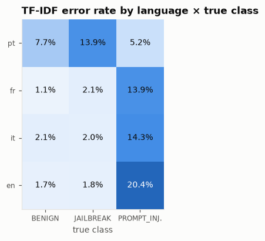
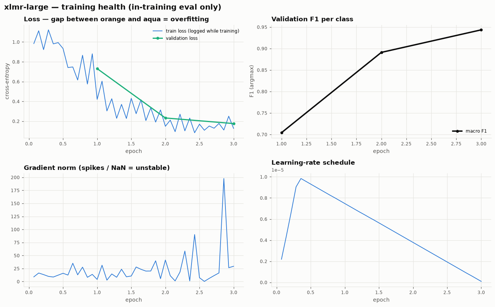
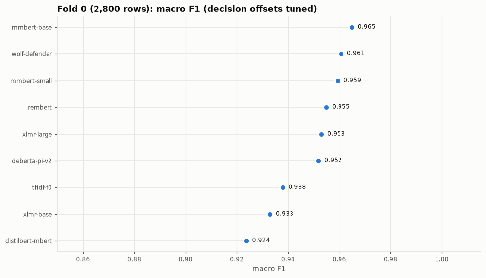
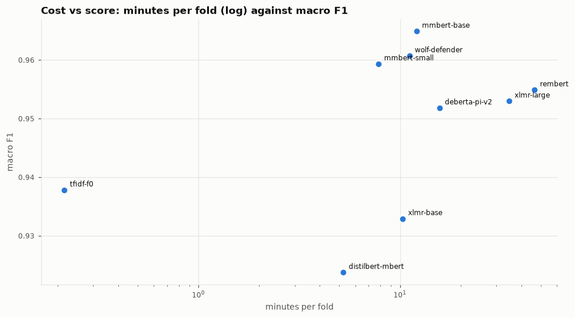
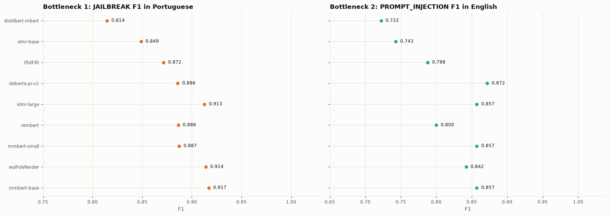
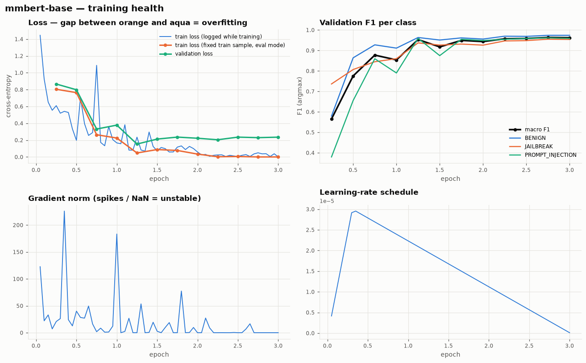

# Plan — Team GenData · RMIT Hackathon 2026 · Challenge 1

> Cập nhật: **21/10/2026, 21:40 giờ VN**. Deadline Kaggle: **22/10/2026 18:00 giờ VN** (11:00 UTC).
> Mục tiêu: **CV macro F1 ≥ 0.975** và nộp bản cuối trước **17:00 ngày 22/10**.

---

## 0. Đã làm gì (21/10, 20:00 → nay)

### 0.1 Tóm tắt một dòng
Đọc đề qua Kaggle API → dựng repo + CI/CD → EDA + baseline TF-IDF → chạy GPU thật trên Kaggle, **tìm và sửa 3 lỗi**
(hết VRAM, split lệch giữa local và Kaggle, dự đoán bị xáo thứ tự) → đang chạy **benchmark cả 10 model qua đêm**,
tự động: benchmark → tune 2 model tốt nhất → LLM → holdout cho model thắng. **Chưa nộp bài nào lên BTC.**

### 0.2 Dữ liệu & cách chia
| mục | chi tiết |
|---|---|
| Dữ liệu | `train.csv` 14.000 dòng (pt 6.300 · fr 3.500 · it 2.800 · en 1.400), `test.csv` 6.000 dòng; mỗi ngôn ngữ đúng 62% BENIGN / 31% JAILBREAK / 7% PI |
| Tiền xử lý | không sửa text. Chỉ chuẩn hoá NFKC + lower + gộp khoảng trắng để **băm MD5** tìm prompt trùng (kết quả: không có trùng) |
| Split *full* | 5 fold, phân tầng theo **nhãn × ngôn ngữ**, gom nhóm theo hash; bằng `numpy.RandomState(42)` → fingerprint **`10a79e50dde8`** (giống hệt trên Python 3.11 / 3.13) |
| Split *holdout* | khoá 20% (2.802 dòng) cùng cách phân tầng, 5 fold trên 80% còn lại (11.198 dòng) → fingerprint `c03bfc97563a` |
| Benchmark | chỉ **fold 0** của split full: train 11.200 dòng, chấm 2.800 dòng — **mọi model chấm trên đúng 2.800 dòng này** |

### 0.3 Công thức train (chung cho mọi model GPU)
| thành phần | giá trị | lý do |
|---|---|---|
| Đầu ra | `AutoModelForSequenceClassification`, 3 lớp (đầu phân loại khởi tạo lại; 2 model safety có đầu 2 lớp cũng được khởi tạo lại) | |
| Cắt prompt | **đầu + đuôi**: tối đa 512 token = 384 token đầu + 128 token cuối | 98% prompt ≤ 512 token; jailbreak dài có phần dựng vai ở đầu, yêu cầu thật ở cuối |
| Loss | cross-entropy có trọng số lớp `sqrt` = **[0.557, 0.787, 1.656]** (B, J, PI) | nâng lớp PI 7% mà không quá tay như `balanced` [0.25, 0.51, 2.24] |
| Optimizer | AdamW, weight decay 0.01, warmup 10%, lịch **linear** (encoder) / cosine (LLM), `max_grad_norm 1.0` | |
| Độ chính xác | fp16 AMP (T4 không có bf16) | |
| Batch | gom batch theo độ dài (ít padding) | prompt dài từ 10 đến 18.550 ký tự |
| Theo dõi sức khoẻ | đánh giá **4 lần/epoch** trên fold val **và** trên 512 mẫu train cố định (cùng cách tính loss → so được train vs val = thấy overfit); log grad norm, LR, thời gian, VRAM | |
| Chọn checkpoint | không: lấy epoch cuối | CV không bị lạc quan |
| Dự đoán | vòng lặp riêng (không dùng `Trainer.predict`), sắp theo độ dài rồi trả về đúng hàng; **chốt chặn**: nếu F1 cuối thấp hơn F1 lúc train > 0.05 thì báo lỗi | xem lỗi #3 |
| Quyết định | cộng **offset vào log-xác suất từng lớp** rồi argmax; offset học trên OOF (lưới −3…3 bước 0.05, 3 vòng) | argmax không tối ưu macro F1 khi lớp lệch |
| Điểm tin được | *cross-fitted*: offset học trên các fold khác, chấm trên fold còn lại; với holdout: offset học trên dev, chấm holdout 1 lần | |

### 0.4 Cấu hình từng model trong benchmark (mặc định, **chưa tune**)
| model | kích thước | GPU | max_len | lr | epoch | batch × accum | đặc biệt |
|---|---|---|---|---|---|---|---|
| `distilbert-mbert` | 135M | 1 T4 | 512 | 5e-5 | 3 | 32 × 1 | |
| `mmbert-small` | 140M | 1 T4 | 512 | 5e-5 | 3 | 32 × 1 | |
| `xlmr-base` | 278M | 1 T4 | 512 | 2e-5 | 3 | 16 × 1 | |
| `mmbert-base` | 307M | 1 T4 | 512 | 3e-5 | 3 | 16 × 1 | đóng băng embedding |
| `wolf-defender` | 307M (mmBERT-base đã học prompt injection) | 1 T4 | 512 | 3e-5 | 3 | 16 × 1 | đóng băng embedding |
| `deberta-pi-v2` | 184M (DeBERTa-v3 đã học prompt injection, vocab EN) | 1 T4 | 512 | 2e-5 | 3 | 16 × 1 | |
| `xlmr-large` | 560M | 1 T4 | 512 | **1.5e-5** | **4** | 8 × 4 | đóng băng embedding, gradient checkpointing |
| `rembert` | 576M | 1 T4 | 512 | 1e-5 | 3 | 8 × 4 | đóng băng embedding, gradient checkpointing |
| `granite-2b-lora` | 2.5B, 4-bit NF4 | 1 T4 | 512 | 1e-4 | 1 | 4 × 4 | LoRA r16 α32 dropout 0.05 trên mọi lớp linear, `paged_adamw_8bit` |
| `mistral-7b-lora` | 7.2B, 4-bit NF4 | 1 T4 | 512 | 1e-4 | 1 | 4 × 4 | như trên |

Mỗi phiên Kaggle (T4 × 2) chạy **2 model song song, mỗi model một GPU** (`tools/build_kernel.py bench`), vì tài khoản chỉ được 1 phiên GPU một lúc.
Môi trường Kaggle đo được: Python 3.13 · torch 2.11 + CUDA 12.8 · transformers 5.16.1 · 2 × Tesla T4 14,56 GB.

### 0.5 Ba lỗi đã tìm ra và sửa (mỗi lỗi đều làm sai kết quả nếu không phát hiện)
| # | triệu chứng | nguyên nhân | cách sửa | kiểm chứng |
|---|---|---|---|---|
| 1 | `xlmr-large` v1 chết sau 2 phút: **CUDA OOM** GPU 0 | DataParallel dồn trọng số + Adam + gradient reduce lên GPU 0 | 1 GPU/model, đóng băng embedding 256M tham số, gradient checkpointing | v2 chạy hết, đỉnh VRAM 7,1 GB |
| 2 | Kaggle in split `0065cdef5245`, local `70e83271a091` | `StratifiedGroupKFold` của sklearn cho kết quả khác giữa các phiên bản | tự chia fold bằng `numpy.RandomState` (luồng số cố định theo cam kết của NumPy) | Python 3.11 + NumPy 1.26 và Python 3.13 + NumPy 2.2 cùng ra `10a79e50dde8` |
| 3 | `xlmr-large` v2: lúc train val F1 **0.9435**, nhưng OOF cuối **0.346** | `Trainer.predict` (transformers 5) trả hàng **khác thứ tự** đầu vào (label_ids không khớp) | vòng dự đoán riêng + chốt chặn so với F1 lúc train | dựng lại được trên local (0.988 → 0.267); sau sửa 1.0 = 1.0 |

Run `mmbert-base` và `wolf-defender` đầu tiên cũng bị lỗi #3: chỉ đường cong lúc train của chúng là đúng (lưu ở `experiments/02-pipeline-debug/`). Cả hai được chạy lại trong benchmark.

### 0.6 Hạ tầng đã dựng
`src/rmitguard/` (split, train, offset, ensemble, biểu đồ) · `configs/` (10 model + TF-IDF + biến thể tự sinh trong `configs/sweep/`) ·
`tools/build_kernel.py` (repo → notebook Kaggle; `train` / `bench` / `ensemble`) · `tools/overnight.py` (điều phối qua đêm) ·
`tools/collect_experiments.py` (gom mọi run → `experiments/`) · `tools/submit.py` (nộp có kiểm tra) · CI GitHub Actions (lint, test, smoke HF Trainer, build notebook) ·
26 test chạy trên dữ liệu tổng hợp.

## 1. Kết quả thí nghiệm & insight

> Toàn bộ biểu đồ + report từng run: [`experiments/README.md`](experiments/README.md). Bảng dưới được cập nhật khi các giai đoạn qua đêm xong.

### 1.1 Baseline TF-IDF (CPU, đã xong)
| run | đánh giá trên | macro F1 | F1 B | F1 J | F1 PI | pt J | en PI |
|---|---|---|---|---|---|---|---|
| `tfidf` | OOF 5 fold (14.000) | **0.9314** (cross-fit) | 0.955 | 0.923 | 0.921 | 0.855 | 0.839 |
| `tfidf-f0` | fold 0 (2.800) — **mốc benchmark** | **0.9378** (tuned) / 0.9354 (argmax) | | | | | |
| `tfidf-ho` | holdout 20% (2.802) | **0.9253** (CI 0.912–0.937) · dev x-fit 0.9257 | 0.948 | 0.915 | 0.913 | 0.836 | 0.872 |



**Insight từ dữ liệu + baseline**
1. **CV đáng tin:** dev cross-fit 0.9257 ≈ holdout 0.9253 → chọn model bằng CV/holdout, không bằng public LB (1.800 dòng → khoảng tin cậy 95% rộng ±0.015).
2. **Lỗi tập trung ở 2 chỗ:** (a) **BENIGN ↔ JAILBREAK trong tiếng pt** (sai 7,7% / 13,9%) — prompt nhập vai dài mà *cả hai lớp* đều nhập vai;
   (b) **PROMPT_INJECTION ở fr / it / en** (sai 14–20%) — injection ngắn, mập mờ. Ngược lại PI tiếng pt chỉ sai 5%.
3. Chỉnh offset theo lớp giúp ít với TF-IDF (+0.001–0.003) vì LR với `class_weight=balanced` đã cân; với transformer dùng trọng số `sqrt` sẽ giúp nhiều hơn.
4. **Độ dài chia bài toán làm hai:** dưới 100 ký tự có **0 JAILBREAK** (3.928 BENIGN + 494 PI — tức *một nửa* số PI là prompt ngắn);
   từ 300 ký tự trở lên JAILBREAK chiếm đa số. → Prompt ngắn = bài BENIGN vs PI; prompt dài = bài BENIGN vs JAILBREAK.

   | độ dài (ký tự) | BENIGN | JAILBREAK | PI |
   |---|---|---|---|
   | < 100 | 3.928 | **0** | 494 |
   | 100–299 | 1.447 | 914 | 274 |
   | 300–799 | 1.620 | 2.186 | 122 |
   | 800–1.999 | 1.418 | 1.178 | 68 |
   | ≥ 2.000 | 267 | 62 | 22 |

### 1.2 Lần chạy GPU đầu tiên (`xlmr-large`, lr 1e-5, 3 epoch — trước khi sửa lỗi #3)


- Val macro F1 theo epoch **0.70 → 0.89 → 0.94**, val loss vẫn giảm → **chưa học xong** → benchmark tăng lên lr 1.5e-5, 4 epoch.
- Epoch 1 rất chậm (F1 0.70): XLM-R large "khởi động" chậm với lr thấp + warmup → cần đủ epoch.
- Grad norm có đỉnh tới ~200 (trước khi cắt về 1.0) ở cuối train: fp16 + lr cao hơn có thể mất ổn định → theo dõi ở bản 4 epoch.
- 1 fold = **22 phút** trên 1 T4, đỉnh VRAM 7,1 GB → 5 fold ≈ 2 giờ trên 1 GPU, ≈ 1 giờ nếu chia 2 GPU.

**`mmbert-base` bản đầu (2 GPU, trước sửa lỗi #3 — chỉ số lúc train, argmax, fold 0):** val macro F1 theo epoch
0.86 (0.75) → 0.947 (2.0) → **0.959** (3.0); val loss thấp nhất **0.167 ở epoch 2** rồi tăng lên 0.205 → bắt đầu overfit nhẹ nhưng F1 vẫn tăng;
có một đỉnh val loss 1.68 ở cuối epoch 1 (bất ổn, tự hồi phục). 24 phút/fold, VRAM đỉnh 11,5 GB.
**`wolf-defender` bản đầu (cùng điều kiện):** 0.79 (0.25 epoch) → 0.945 (1.25) → đỉnh **0.963** (2.5) → **0.959** (3.0); 24 phút/fold.
So với `mmbert-base` (cùng kiến trúc, chưa học prompt injection): khởi đầu nhanh hơn hẳn (0.79 vs 0.53 ở 1/4 epoch đầu) nhưng **điểm cuối ngang nhau** (0.959).
→ Kiến thức prompt injection tiếng Anh có sẵn giúp hội tụ nhanh, không nâng trần.

| run (fold 0, F1 lúc train, argmax) | macro F1 cuối | đỉnh | phút/fold |
|---|---|---|---|
| TF-IDF (mốc) | 0.935 | — | 0,2 (CPU) |
| `xlmr-large` lr 1e-5, 3 epoch | 0.944 | 0.944 (chưa học xong) | 22 |
| `mmbert-base` | 0.959 | 0.962 (2.7) | 24 |
| `wolf-defender` | 0.959 | 0.963 (2.5) | 24 |

→ Tín hiệu sớm: **họ mmBERT dẫn đầu**, XLM-R large cần thêm epoch. Bảng chính thức (có chỉnh offset, per-language) ở 1.3.

### 1.3 Benchmark 8 encoder (fold 0, cùng 2.800 dòng, code đã sửa) — ✅ xong (`bench-a` 23:17, `bench-b` train xong 00:15)

| hạng | model | **macro F1** (chỉnh offset) | argmax | F1 B | F1 J | F1 PI | **pt J** | **en PI** | phút/fold (1 T4) | VRAM GB | val−train loss |
|---|---|---|---|---|---|---|---|---|---|---|---|
| 1 | **`mmbert-base`** | **0.9649** | 0.9622 | 0.975 | 0.956 | 0.964 | **0.917** | 0.857 | 12 | 7,6 | 0.235 |
| 2 | `wolf-defender` | 0.9607 | 0.9568 | 0.973 | 0.955 | 0.954 | 0.914 | 0.842 | 11 | 7,6 | 0.243 |
| 3 | `mmbert-small` | 0.9593 | 0.9544 | 0.968 | 0.941 | **0.969** | 0.887 | 0.857 | **8** | 8,9 | 0.206 |
| 4 | `rembert` | 0.9549 | 0.9443 | 0.966 | 0.940 | 0.958 | 0.886 | 0.800 | 47 | 10,7 | 0.178 |
| 5 | `xlmr-large` (lr 1.5e-5, 4 epoch) | 0.9530 | 0.9479 | 0.968 | 0.949 | 0.942 | 0.913 | 0.857 | 35 | 7,1 | 0.202 |
| 6 | `deberta-pi-v2` | 0.9518 | 0.9484 | 0.966 | 0.939 | 0.950 | 0.886 | **0.872** | 16 | 13,4 | 0.174 |
| — | *TF-IDF (mốc)* | *0.9378* | *0.9354* | *0.958* | *0.927* | *0.929* | *0.872* | *0.788* | *0,2 (CPU)* | — | — |
| 7 | `xlmr-base` | 0.9329 | 0.9297 | 0.951 | 0.919 | 0.930 | 0.849 | 0.743 | 10 | 7,0 | 0.168 |
| 8 | `distilbert-mbert` | 0.9237 | 0.9201 | 0.943 | 0.904 | 0.925 | 0.815 | 0.722 | 5 | 5,2 | 0.138 |






**Kết luận benchmark → B\* = `mmbert-base`** (cao nhất, chỉ 12 phút/fold, mạnh nhất ở điểm nghẽn #1 pt JAILBREAK).
- **Model to không thắng:** `xlmr-large` (35 phút) và `rembert` (47 phút) đều **thua `mmbert-base` (12 phút)** — chậm gấp 3–4 lần mà kém 0.01.
- **`mmbert-small` rất đáng giá:** 0.959 chỉ với 8 phút/fold, PI tốt nhất (0.969) → nếu BTC cho ghép nhiều backbone thì đây là ứng viên ghép số 1; nếu không, đây là phương án dự phòng rẻ.
- **Model "đã học prompt injection" không giúp đáng kể:** `wolf-defender` < `mmbert-base`; `deberta-pi-v2` chỉ nhỉnh ở en PI.
- Họ XLM-R / DistilBERT đa ngữ đời cũ **thua TF-IDF** → tokenizer/pre-train đa ngữ mới (mmBERT, 1.800 ngôn ngữ) tạo khác biệt lớn nhất.
- Không còn chỗ cho 2 model khác nhau trong bản nộp (luật 1 backbone) → **tăng điểm bằng seed + 5 fold + chống overfit**, không bằng đổi model.

**Insight chi tiết (từ `bench-a`)**
1. **Họ mmBERT dẫn đầu.** `mmbert-base` 0.9649 > `wolf-defender` 0.9607: bản "đã học prompt injection" (tiếng Anh) **không** hơn bản gốc khi đã fine-tune trên dữ liệu đề.
2. **`xlmr-base` thua cả TF-IDF** (0.933 < 0.938), yếu nhất ở đúng 2 điểm nghẽn (pt J 0.849, en PI 0.743) → loại.
3. **`deberta-pi-v2` giỏi PI tiếng Anh nhất (0.872)** nhờ đã học prompt injection, nhưng vocab tiếng Anh làm nó yếu ở pt (0.886).
4. **mmBERT học thuộc train từ epoch 2:** loss trên mẫu train ≈ 0, val loss đi ngang từ epoch 1,25, F1 chỉ nhích thêm 0.005 sau đó.
   → train **dài hơn vô ích**; nên **chống overfit** (label smoothing, ít epoch) và **ensemble nhiều seed** để tăng điểm.
   Đợt `tune` đã được đổi sang: `-ls` (label smoothing 0.1), `-ep2` (2 epoch), `-lang` (nhãn ngôn ngữ), `-cw0` (bỏ trọng số lớp).
5. Chỉnh offset giúp +0.003–0.004 cho mọi model → luôn bật.
6. Encoder base chạy **11–16 phút/fold trên 1 T4** → 5 fold ≈ 1 giờ trên 1 GPU, ≈ 30 phút nếu chia 2 GPU.

## 2. Tình hình hiện tại

| hạng mục | trạng thái |
|---|---|
| Đăng ký cuộc thi (tài khoản lead `longquanton`) | ✅ đã Join |
| Repo GitHub | ✅ Private · CI chạy mỗi push |
| Dữ liệu | ✅ đã tải (`make data`) · EDA xong (`reports/eda.md`) |
| Baseline TF-IDF (CPU, local) | ✅ **CV 0.9314** (cross-fitted) — chỉ để làm mốc, **không nộp** |
| Benchmark encoder (fold 0) | ✅ **8/8 encoder xong** (mục 1.3) → **B\* = `mmbert-base` 0.9649**. LLM, tune, v1, holdout **chưa chạy** (hết quota, mục 8.0) |
| Quota GPU `longquanton` | ⚠️ **6 giờ/tuần, đã dùng hết**, reset 24/10 → hôm nay GPU chạy trên tài khoản B/C/D |
| Split local ↔ Kaggle | ✅ đã sửa: trước đó sklearn khác phiên bản chia fold khác nhau; nay dùng `numpy.RandomState` → cùng `10a79e50dde8` |
| Submission | 0 — **không nộp gì lên BTC trong đêm**; bài đầu tiên nộp sáng 22/10 (sau 07:00), khi đã có benchmark |
| Team trên Kaggle | ☐ cần lập (tối đa 4 người) **trước khi ai nộp bài** |
| Câu hỏi gửi BTC | ☐ "Được ensemble nhiều model trong danh sách không, hay chỉ một?" |

**Leaderboard public (21/10 ~20:00):** top **0.97185** · hạng 5 ≈ 0.961 · notebook mẫu của BTC 0.908 · đoán toàn BENIGN ≈ 0.26.
Public LB chỉ chấm **30% test (~1.800 dòng)** → nhiễu ±0.01. Thứ hạng cuối dựa trên 70% còn lại (private).

## 3. Luật — những điều bắt buộc

| # | luật | hệ quả cho mình |
|---|---|---|
| 1 | Chỉ dùng **MỘT backbone** trong 10 model được duyệt; ghi tên model ở đầu notebook | `build_kernel.py` tự ghi; `ensemble` chặn trộn backbone (trừ khi BTC cho phép) |
| 2 | **6 lượt nộp / ngày**, reset 07:00 giờ VN | mỗi lượt đi qua `tools/submit.py` (validate + log) |
| 3 | Team tối đa **4 người**, mỗi người 1 tài khoản Kaggle | lập team **trước** khi nộp — gộp sau bị giới hạn lượt |
| 4 | Tên notebook `<university>_<campus>_<team>_C1` | bản chính thức: **`RMIT_SGS_GenData_C1`**; thí nghiệm: `RMIT_SGS_GenData-<exp>_C1` (vẫn đúng luật) |
| 5 | "Submit notebooks to get higher score" | nộp từ **output của notebook**, không nộp file làm tay |
| 6 | Có điểm C1 ngay khi có **submission hợp lệ đầu tiên** | nộp bản đầu tiên ngay đầu giờ sáng 22/10 |
| 7 | Không chia sẻ code ngoài team trong lúc thi; dữ liệu CC BY-NC-SA | repo Private, không commit data (pre-commit + CI chặn) |
| 8 | Không dùng nhãn tay / dự đoán của người trên test | pseudo-label bằng model thì được, gán tay thì không |

Danh sách model được duyệt (key dùng trong `configs/`):

| key | model | loại |
|---|---|---|
| `xlmr-base` / `xlmr-large` | FacebookAI/xlm-roberta-base / large | encoder đa ngữ |
| `mmbert-small` / `mmbert-base` | jhu-clsp/mmBERT-small / base | encoder đa ngữ, context dài |
| `distilbert-mbert` | distilbert-base-multilingual-cased | encoder nhỏ |
| `rembert` | google/rembert | encoder (batch 8) |
| `deberta-pi-v2` | protectai/deberta-v3-base-prompt-injection-v2 | encoder đã học prompt injection (EN) |
| `wolf-defender` | patronus-studio/wolf-defender-prompt-injection | encoder đã học prompt injection |
| `granite-2b` | ibm-granite/granite-3.3-2b-instruct | LLM (4-bit + LoRA) |
| `mistral-7b` | mistralai/Mistral-7B-Instruct-v0.3 | LLM (4-bit + LoRA) |

## 4. Đề bài & dữ liệu — những gì đã biết chắc

- 3 lớp: `BENIGN` 62% · `JAILBREAK` 31% · `PROMPT_INJECTION` 7%; 4 ngôn ngữ: pt 45% · fr 25% · it 20% · en 10%.
- **Mọi ngôn ngữ có đúng tỉ lệ 62/31/7**, không có prompt trùng, test không trùng train, phân bố train = test
  → không có leak để khai thác; thắng bằng model.
- Prompt ngắn: **median 71 token, trung bình 120**; `max_len 512` chỉ cắt 2.1%.
- **Macro F1** → lớp PI (7%) nặng bằng BENIGN (62%) → phải chỉnh ngưỡng theo lớp (đã có, tự bật).
- **Điểm nghẽn #1 — BENIGN ↔ JAILBREAK trong tiếng Bồ Đào Nha:** TF-IDF sai ~11% ở pt, chỉ 1–2.5% ở fr/it/en
  (~610/820 lỗi B↔J). Đó là các prompt **nhập vai dài** mà *cả hai lớp đều nhập vai*; khác nhau ở chỗ yêu cầu bên dưới
  có hại hay không → cần model **hiểu nghĩa**, không phải bắt từ khoá.
- **Điểm nghẽn #2 — PROMPT_INJECTION bị đoán BENIGN:** 112 lỗi, tệ nhất ở **en (sai 24.5%)**: injection ngắn, mập mờ
  ("Sans tenir compte des articles…"), có thể có nhãn nhiễu.

→ **Chọn model theo `f1_JAILBREAK` của pt và `f1_PROMPT_INJECTION` của en** (bảng *Per language* trong `report.md`),
không chỉ theo macro F1 tổng.

## 5. Ta đang có gì

| công cụ | dùng để |
|---|---|
| `configs/*.yaml` | 1 file = 1 thí nghiệm. Có sẵn đủ **10 model được duyệt** + `tfidf` (mốc, không nộp) |
| `make push CONFIG=… [FOLDS=…] [HOLDOUT=0.2]` | build notebook từ code hiện tại → đẩy lên Kaggle → chạy trên T4 |
| `tools/bench_queue.py` | xếp hàng nhiều notebook trên 1 tài khoản (tối đa 2 chạy cùng lúc), xong cái nào tự tải output cái đó |
| `tools/bench_report.py` | vẽ lại biểu đồ mọi run + biểu đồ so sánh → `reports/bench/BENCH.md` |
| `artifacts/<name>/report.md` | điểm (CV / holdout), per class, per language, confusion, thời gian, VRAM |
| `artifacts/<name>/charts/` | `training_health.png` (loss train vs val, F1 theo epoch, grad norm, LR) · `confusion.png` · `slices.png` (F1 theo ngôn ngữ và độ dài) · `confidence.png` (độ tự tin + reliability) |
| `artifacts/<name>/top_errors.csv` | 60 lỗi tự tin nhất kèm text — để soi |
| `make push-ensemble SOURCES=… ONLY=…` | ghép fold / seed / config của **cùng backbone** từ nhiều notebook (`ONLY` = chỉ lấy các run có tên này, bắt buộc khi notebook nguồn train nhiều model) |
| `make submit-dry / submit KERNEL=…` | validate + đếm lượt hôm nay + nộp + ghi `experiments/submissions.csv` |
| `experiments/LOG.md` | nhật ký mọi run |

**Hai split cố định** (giống hệt nhau trên máy local và trên Kaggle, đã kiểm tra với Python 3.11 và 3.13):

| split | dùng cho | fingerprint |
|---|---|---|
| full: 5 fold trên 14.000 dòng | benchmark (fold 0) và **model nộp bài** | **`10a79e50dde8`** |
| holdout: khoá 20% (2.800 dòng) + 5 fold trên 80% còn lại | **ước lượng private LB** cho baseline | in ra trong `report.md` của run `-ho` |

Muốn thêm thành viên ensemble thì đổi `seed` (seed train), **không đổi `split_seed`**.

## 6. Quy trình đánh giá — 3 giai đoạn

**GĐ1 · Benchmark (tối nay, lead chạy một mình).** Cả 10 model, **chỉ fold 0** của split full: train 11.200 dòng, chấm 2.800 dòng.
- Điểm so sánh = macro F1 sau khi chỉnh ngưỡng trên chính fold 0. Hơi lạc quan, nhưng **như nhau cho mọi model** nên so sánh công bằng. Kèm điểm argmax.
- **Mốc:** TF-IDF fold 0 = **0.9378** (đã chỉnh ngưỡng) / 0.9354 (argmax). Model nào không vượt rõ mốc này thì loại.
- Chênh **≥ 0.01** mới đáng tin (giữa các fold TF-IDF dao động 0.926–0.937).
- Tiêu chí chọn, theo thứ tự: macro F1 → **pt JAILBREAK F1** → **en PI F1** → khoảng cách val−train loss (overfit) → phút/fold.

**GĐ2 · Holdout cho baseline (sáng sớm 22/10).** Model thắng GĐ1 (B\*) chạy `HOLDOUT=0.2`:
- 2.800 dòng bị khoá, model không bao giờ thấy.
- 5 fold trên dev 11.200 dòng; ngưỡng học trên OOF của dev, rồi **chấm holdout đúng một lần** → ước lượng private LB, kèm CI 95%.
- Mục đích: (1) biết B\* thật sự được bao nhiêu điểm trước khi dồn GPU vào nó; (2) so CV ↔ holdout ↔ public LB để biết tin con số nào.
- TF-IDF holdout chạy local làm mốc (`uv run rmitguard train configs/tfidf.yaml --holdout 0.2`).

**GĐ3 · Bản cuối.** B\* chạy đủ 5 fold trên split full (fold 0 đã có từ GĐ1, tái dùng) → ghép → thêm seed / biến thể → nộp.

## 7. QUA ĐÊM (21/10 → 22/10) — chạy tự động, không nộp bài

> **Cập nhật 02:35:** chỉ `bench-a` chạy xong. `bench-b` chạy > 3 giờ (dự kiến ~80 phút, chưa rõ nguyên nhân — Kaggle không cho xem log khi đang chạy)
> và tài khoản **hết quota GPU (6 giờ/tuần)** → script điều phối đã dừng, các đợt dưới đây **chuyển sang tài khoản B/C/D hôm nay** (mục 8.0).

`tools/overnight.py` chạy nền trên máy lead, tài khoản `longquanton` (1 phiên GPU một lúc, mỗi phiên 2 model song song):

| giai đoạn | notebook | jobs (fold 0 split full trừ khi ghi khác) | ước tính | trả lời câu hỏi |
|---|---|---|---|---|
| chờ | — | 2 run cũ còn trên Kaggle (`mmbert-base`, `wolf-defender` bản lỗi #3) | đến ~22:30 | |
| `bench-a` | `rmit-sgs-gendata-bench-a-c1` | `wolf-defender`, `xlmr-base`, `mmbert-base`, `deberta-pi-v2` | ~35 phút | encoder base nào mạnh nhất? model đã học prompt injection có lợi thế? |
| `bench-b` | `rmit-sgs-gendata-bench-b-c1` | `mmbert-small`, `distilbert-mbert`, `xlmr-large`, `rembert` | ~50 phút | model lớn có đáng chậm gấp 3? |
| `tune` | `rmit-sgs-gendata-tune-c1` | **tự chọn** 2 encoder đứng đầu → model #1: `-ls` (label smoothing 0.1), `-ep2` (2 epoch), `-lang` (nhãn ngôn ngữ), `-cw0` (bỏ trọng số lớp); model #2: `-ls`, `-lang` | ~1–1,5 giờ | chống overfit có tăng điểm không? |
| `full` → **v1** | `rmit-sgs-gendata-full-c1` | config tốt nhất (kể cả biến thể), **fold 1-2 trên GPU 0 + fold 3-4 trên GPU 1**; fold 0 lấy lại từ bench/tune → máy lead tự ghép 5 fold = **v1** → `experiments/07-v1/<config>/submission.csv` | ~40 phút | v1 sẵn sàng trước sáng |
| `holdout` | `rmit-sgs-gendata-holdout-c1` | cùng config, **holdout 20%**, fold 0-1-2 / 3-4 | ~1 giờ | ước lượng private LB |
| `llm` | `rmit-sgs-gendata-llm-c1` | `granite-2b-lora`, `mistral-7b-lora` | ~3 giờ | LLM có thắng encoder ở pt B↔J không? (thông tin cho ngày thi) |

Mỗi giai đoạn xong → tự tải output về `outputs/` → `tools/collect_experiments.py` cập nhật `experiments/` (biểu đồ từng run + so sánh).
Theo dõi: `tail -f outputs/overnight.log`. Dự kiến (đã lùi ~40 phút vì `bench-b` chậm): v1 sẵn sàng **~03:15**, holdout ~04:15, LLM **~07:00–07:30**.

Các thành viên khác tối nay chỉ cần: Join competition → nhận lời mời team → `make setup && make data && make baseline` (phải ra CV 0.9314).

## 8. NGÀY THI (22/10) — timeline

### ⚠️ 8.0 Quota GPU — đọc trước (phát hiện 02:35, **cập nhật 06:55**)

> **Cập nhật 06:55:** Kaggle đã **hoàn trả** phần quota bị phiên `bench-b` treo đốt (API: 2,66 giờ đã dùng), và trang web của lead báo
> **còn ~27 giờ T4** (API chỉ báo mức tối thiểu 6 giờ — lấy số trên web làm chuẩn). Giới hạn thật sự là **tối đa 2 phiên GPU chạy cùng lúc / tài khoản**
> (`Maximum batch GPU session count of 2 reached`). Các ghi chú bên dưới về "hết quota" chỉ còn giá trị lịch sử.
> Đang chạy trên `longquanton` từ 06:46: **s1** (Granite fold 0 + mmbert-base fold 1–4 → v1), **s2** (seed 2 + 4 biến thể tune);
> xếp hàng tự động (`tools/push_when_free.py`): **s3** (Mistral fold 0 + seed 3), **s4** (mmbert-base holdout 20%).


- Tài khoản `longquanton` chỉ có **6 giờ GPU / tuần** (Kaggle API: `totalTimeAllowed 21600s`), **đã dùng hết ~6 giờ** sau đêm nay, reset **24/10** → **hôm nay lead không chạy GPU được**, chỉ chạy notebook CPU (ensemble) và nộp bài.
- **Nguyên nhân hết quota:** notebook `bench-b` **chạy xong ở phút 56** (log: 4 job rc=0, xuất `__results__.html` lúc 56,3 phút) nhưng Kaggle
  vẫn để phiên ở trạng thái *RUNNING* thêm **~6 giờ** (tới 06:24) và **tính quota suốt thời gian đó**. Output 2 đợt giống nhau (7,5 MB) → lỗi phía Kaggle, chưa rõ gốc.
  **Phòng tránh hôm nay: luôn đẩy với giới hạn thời gian** `kaggle kernels push -p <dir> -t <giây>` (hoặc `make push … TIMEOUT=<giây>`),
  đặt ≈ 2× thời gian dự kiến (encoder 5 fold trên 2 GPU: `-t 3600`; Granite 1 fold: `-t 7200`), và mở trang notebook kiểm tra nếu quá giờ.
- Quota tính theo **thời gian phiên**, không nhân số GPU (tổng các phiên ~5,2 giờ ≈ quota đã dùng 5,0 giờ) → **luôn chạy 2 job / phiên** (`tools/build_kernel.py bench … @folds`).
- Đợt `tune`, `full` (v1), `holdout`, `llm` của đêm **không chạy được** → chuyển sang tài khoản B, C, D hôm nay.
- **Mỗi thành viên kiểm tra quota ngay khi dậy:** Kaggle → Settings → *Accelerator quota*, hoặc
  `uv run python -c "from kaggle.api.kaggle_api_extended import KaggleApi as K; from kagglesdk.kernels.types.kernels_api_service import ApiGetAcceleratorQuotaStatisticsRequest as R; a=K(); a.authenticate(); c=a.build_kaggle_client().__enter__(); print(c.kernels.kernels_api_client.get_accelerator_quota_statistics(R()).to_dict()['gpuQuota'])"`

**Ngân sách hôm nay** (giả sử mỗi người 6 giờ như lead; nhiều hơn thì càng tốt):

| việc | tài khoản | 1 phiên (2 GPU) | quota tốn |
|---|---|---|---|
| **v1**: `mmbert-base` fold 1-2 / 3-4 (fold 0 có sẵn) | B | ~35 phút | ~0,6 h |
| **seed 2** `mmbert-base-s2` fold 0-1-2 / 3-4 | C | ~45 phút | ~0,8 h |
| **seed 3** `mmbert-base-s3` | D | ~45 phút | ~0,8 h |
| tune fold 0: `-ls`, `-ep2`, `-lang`, `-cw0` | B (phiên 2) | ~30 phút | ~0,5 h |
| holdout `mmbert-base` (ước lượng private LB) | C (phiên 2) | ~40 phút | ~0,7 h |
| LLM: `granite-2b-lora` fold 0 (+ 1 job encoder trên GPU kia) | D (phiên 2) | ~1,5 giờ | ~1,5 h |
| **tổng** | | | **~5 h / 18 h** |

Mistral-7B (~3–4 giờ/fold) **không khả thi** với quota 6 giờ/người → bỏ, chỉ thử Granite.


**B\*** = config của v1 (chọn tự động trong đêm theo fold-0 macro F1; tới 23:40 đang dẫn là `mmbert-base` 0.9649 — xem `outputs/overnight.json`).
~~Fold 0, holdout và đủ 5 fold của B\* đã chạy trong đêm~~ → **không chạy được vì hết quota (mục 8.0)**; chỉ fold 0 (`bench-a`) có sẵn.
Slug notebook dạng `rmit-sgs-gendata-<tag>-c1`; seed mới = copy config, đổi `name` + `seed` (giữ `split_seed`).

| giờ VN | việc | ai | lệnh / ghi chú |
|---|---|---|---|
| 06:30–07:00 | Đọc `outputs/overnight.log`, `experiments/README.md`, Plan mục 1 (bảng + biểu đồ đã cập nhật) | A | |
| 06:30 | Nếu `bench-b` vẫn *running* (treo từ ~23:20, 04:07 vẫn chưa xong): mở https://www.kaggle.com/code/longquanton/rmit-sgs-gendata-bench-b-c1 → **Cancel run**. Không ảnh hưởng tài khoản khác | A | |
| **07:00–07:10** | **Submission #1 = baseline**: `mmbert-base` fold 0 (đã có từ `bench-a`, fold-0 macro F1 0.9649) | A | `make validate FILE=outputs/rmit-sgs-gendata-bench-a-c1/artifacts/mmbert-base-f0/mmbert-base/submission.csv` → `uv run python tools/submit.py --file <file> -m "baseline mmbert-base f0 cv=0.9649" --yes` |
| **07:00** | Tài khoản B đẩy **v1** (fold 1-4 của `mmbert-base`, mục 8.0) ngay khi dậy; C, D đẩy seed 2 / seed 3 | B, C, D | `uv run python tools/build_kernel.py bench configs/mmbert-base.yaml@1,2 configs/mmbert-base.yaml@3,4 --tag full` → `uv run kaggle kernels push -p kaggle/build/rmit-sgs-gendata-full-c1 -t 3600` |
| **~07:45** | **Submission #2 = v1**: B\* 5 fold (fold 0 từ `bench-a` + fold 1-4 của B) — nộp *từ notebook* (notebook ensemble trên Kaggle, CPU, ~5–10 phút) | A | `make push-ensemble SOURCES=longquanton/rmit-sgs-gendata-<bench-a hoặc tune>-c1,longquanton/rmit-sgs-gendata-full-c1 ONLY=<B*>` → `make submit KERNEL=longquanton/rmit-sgs-gendata-ensemble-c1 MSG="v1 … cv=…"`. Dự phòng: nộp file `experiments/07-v1/<B*>/submission.csv` |
| 07:15 | **Seed 2 và seed 3 của B\*** (5 fold mỗi seed) trên tài khoản thành viên — mỗi tài khoản 1 notebook `bench` 2 GPU | B, C | tạo config: `uv run python -c "import sys; sys.path[:0]=['tools','src']; import overnight as o; print(o.make_variants('<B*>', ['s2','s3']))"` → `uv run python tools/build_kernel.py bench configs/sweep/<B*>-s2.yaml@0,1,2 configs/sweep/<B*>-s2.yaml@3,4 --tag s2` → `kaggle kernels push -p kaggle/build/rmit-sgs-gendata-s2-c1 -t 3600` (~35 phút với mmBERT-base) |
| 07:15 | Phân tích lỗi v1 trên OOF 14.000 dòng: `experiments/07-v1/<B*>/` + `top_errors.csv` (pt B↔J, PI fr/it/en) | A, D | |
| ~08:00 | Ghép v1 + seed 2 + seed 3 → **submission #3 = v2** nếu CV cross-fit tăng ≥ 0.003 | A | `make push-ensemble SOURCES=<mọi notebook của B*> ONLY=<B*>,<B*>-s2,<B*>-s3` |
| 07:30 | **Lead duyệt phương án LLM** (mục 8b): kích hoạt hay không, Granite hay Mistral | A | |
| 08:00–12:00 | Theo kết quả đêm: (a) biến thể `tune` thắng → chạy đủ 5 fold; (b) LLM được duyệt → 4 fold trên 2 tài khoản (mục 8b); (c) seed thêm | cả team | |
| 12:00–13:00 | **Submission #4** = ensemble tốt nhất tới lúc này | A | |
| 13:00–15:30 | Còn GPU: pseudo-label test (nhãn model tự tin > 0.98) + seed thêm. Không thì chuẩn bị slide / báo cáo | cả team | |
| **15:30–16:30** | **Notebook chính thức** `RMIT_SGS_GenData_C1` = ensemble tốt nhất → **submission cuối** | A | `uv run python tools/build_kernel.py ensemble --sources <…> --final` → `uv run kaggle kernels push -p kaggle/build/rmit-sgs-gendata-c1 -t 3600` → `make submit KERNEL=longquanton/rmit-sgs-gendata-c1 MSG="final cv=…"` |
| **17:00** | **Đóng băng.** Kaggle → *Submissions* → chọn 2 bản cuối: **CV cao nhất** + 1 bản an toàn | A | |
| 18:00 | Deadline | | |

**Thời gian cho 2 lần nộp đầu:** baseline + v1 ≈ **15–25 phút** (file đã có sẵn từ đêm; chỉ cần validate, chạy notebook ensemble CPU, nộp).
Nếu đợt `full` trong đêm lỗi: chạy 4 fold B\* sáng mai trên 1 tài khoản (2 GPU) ≈ 35–45 phút, hoặc ≈ 20 phút nếu chia 2 tài khoản → v1 khoảng 08:00.

### 8b. Phương án LLM — ⏸ CHỜ DUYỆT sáng 22/10 (chưa triển khai)

Chỉ kích hoạt nếu đợt `llm` trong đêm cho thấy LLM **thắng rõ** encoder tốt nhất. Lead duyệt lúc ~07:30 sau khi xem bảng.

**Điều kiện kích hoạt** (trên fold 0, cùng 2.800 dòng):
1. macro F1 của LLM ≥ encoder tốt nhất **+ 0.005** (dưới mức này là nhiễu giữa các fold, không đáng đổi), **và**
2. LLM tốt hơn ở **pt JAILBREAK** (điểm nghẽn #1 — lý do để dùng LLM), **và**
3. Thời gian 1 fold đo được cho phép xong 5 fold trước **13:00**.

**⚠️ Luật 1 backbone:** chọn LLM ⇒ bản nộp cuối **chỉ gồm LLM đó** (5 fold), bỏ mmBERT. Không ghép LLM + mmBERT trừ khi BTC xác nhận được phép.

**Chọn con nào (Granite-2B hay Mistral-7B):**
| tiêu chí | Granite 3.3 2B | Mistral 7B v0.3 |
|---|---|---|
| kích thước (4-bit) | ~1,5 GB | ~4,5 GB |
| ước tính 1 fold trên 1 T4 (11.200 dòng train, 1 epoch) | **~1–1,5 giờ** | **~3–4 giờ** |
| ngôn ngữ | có pt / fr / it trong danh sách hỗ trợ chính thức | đa ngữ tốt, mạnh tiếng Pháp |
| rủi ro | thấp | cao: lâu, dễ hết thời gian trong ngày |

**Cập nhật 02:35:** quota 6 giờ/người ⇒ **Mistral loại** (1 fold đã 3–4 giờ). Chỉ thử **Granite fold 0** (~1,5 giờ, tài khoản D) rồi mới quyết.

**Quy tắc:** chọn **Granite** mặc định. Chỉ chọn Mistral nếu fold 0 của nó hơn Granite **≥ 0.01** *và* thời gian đo được ≤ 3 giờ/fold.
Thời gian chính xác = cột `min/fold` của đợt `llm` (cùng cỡ dữ liệu ⇒ mỗi fold sau tốn đúng chừng đó).

**Cách train 5 fold nhanh nhất** (fold 0 đã có từ đêm → còn fold 1–4):
- 2 tài khoản × 1 notebook `bench` (2 GPU) = **4 GPU chạy 4 fold cùng lúc** → thời gian ≈ **1 fold + ~10 phút khởi động**.
  `uv run python tools/build_kernel.py bench configs/granite-2b-lora.yaml@1 configs/granite-2b-lora.yaml@2 --tag llm-f12` (tài khoản A) và `…@3 …@4 --tag llm-f34` (tài khoản B).
- Tăng tốc ~20–25% cho bản chạy thật: `evals_per_epoch: 1` (bớt đánh giá giữa chừng), `max_len: 384` (chỉ 4,2% prompt dài hơn).
  Không đổi `split_seed` ⇒ fold 0 của đêm vẫn ghép được.

| phương án | bắt đầu | 4 fold xong | v-LLM nộp được |
|---|---|---|---|
| Granite (1–1,5 h/fold) | 07:45 | ~09:15 | **~09:30** |
| Mistral (3–4 h/fold) | 07:45 | ~11:45 | **~12:00** |

Song song lúc đó: các tài khoản còn lại vẫn chạy seed 2/3 của mmBERT → dù LLM thắng hay thua vẫn có v2 encoder để nộp.

## 9. Quy tắc nộp bài

- Chỉ nộp khi CV cross-fitted tăng **≥ 0.003**, hoặc để kiểm tra một giả thuyết cụ thể. Giữ **1 lượt dự phòng** tới 17:00.
- Luôn chạy thử trước: `make submit-dry KERNEL=<user>/<slug> MSG="…"` (validate file, đếm lượt đã dùng hôm nay).
- Nộp thật: `make submit KERNEL=<user>/<slug> VERSION=<n> MSG="<config> <folds> cv=<…>"`.
  Nếu CLI báo lỗi khi nộp theo kernel: `make output KERNEL=…` rồi
  `uv run python tools/submit.py --file outputs/<slug>/submission.csv -m "…" --yes`, hoặc bấm *Submit* trong tab *Output* của notebook.
- Có điểm public → điền cột `public_lb` trong `experiments/submissions.csv` và `experiments/LOG.md`.
- **Tối nay không nộp.** Submission #1 lúc 07:00–07:15 sáng 22/10 = output fold 0 tốt nhất trong các bài benchmark.
- Hoà điểm thì **bài nộp sớm hơn thắng** (luật 7b) → có kết quả tốt là nộp sớm, đừng dồn tới phút cuối.
- Không tự chọn Final Submission thì **Kaggle tự chọn** (luật 18c) → 17:00 tự chọn 2 bản theo CV.

## 10. Phân vai

| | vai trò | phụ trách |
|---|---|---|
| A | Lead / integrator (`longquanton`) | repo, chốt model, ensemble, mọi lượt nộp, notebook chính thức |
| B | Track encoder | `mmbert-base`, `xlmr-base`, sau đó fold của B\* |
| C | Track LLM nhỏ | `granite-2b-lora`, sau đó fold của B\* |
| D | Track LLM lớn + biến thể | `mistral-7b-lora`, `deberta-pi-v2`, biến thể config, slide / báo cáo |

## 11. Rủi ro & cách xử lý

| rủi ro | dấu hiệu | xử lý |
|---|---|---|
| XLM-R large không học (đoán toàn 1 lớp) | fold macro F1 ≈ 0.26, loss phẳng ~1.0 | `lr: 8.0e-6`, `warmup_ratio: 0.15`, đổi `seed` |
| fp16 ra NaN (mmBERT) | loss `nan` | `fp16: false` hoặc giảm `lr` |
| Hết VRAM | CUDA OOM | giảm `batch_size`, tăng `grad_accum`, `grad_ckpt: true` |
| Notebook bị kill (12 giờ) | dừng giữa chừng | artifact đã lưu sau mỗi fold; `time_budget_hours` tự dừng sớm |
| Hết quota GPU của một tài khoản | push bị từ chối | chuyển fold sang tài khoản khác (cùng config ⇒ cùng split) |
| Không ghép được notebook người khác | ensemble không thấy input | notebook nguồn phải Share cho lead; hoặc `make output` từng cái rồi `make ensemble SOURCES="outputs/a outputs/b"` |
| Nộp sai format | mất 1 lượt | `make submit-dry` trước |
| Bám public LB | public tăng, CV giảm | quyết định theo CV cross-fitted |

## 12. Lệnh tra nhanh

```bash
make help                                        # mọi lệnh
make check                                       # lint + test (giống CI)
make push CONFIG=configs/<x>.yaml FOLDS=0        # chạy trên Kaggle
make status KERNEL=<user>/<slug>                 # queued / running / complete / error
make output KERNEL=<user>/<slug>                 # tải kết quả
make push-ensemble SOURCES=<user>/<slug>,<user>/<slug>
make submit-dry KERNEL=<user>/<slug> MSG="…"     # kiểm tra trước khi nộp
make submit KERNEL=<user>/<slug> VERSION=<n> MSG="…"
```

Chi tiết cách vận hành: [docs/WORKFLOW.md](docs/WORKFLOW.md) · Đề bài đầy đủ: [docs/PROBLEM.md](docs/PROBLEM.md).
