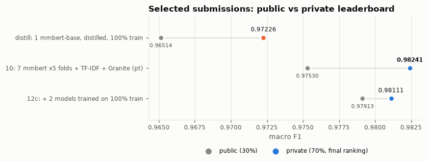
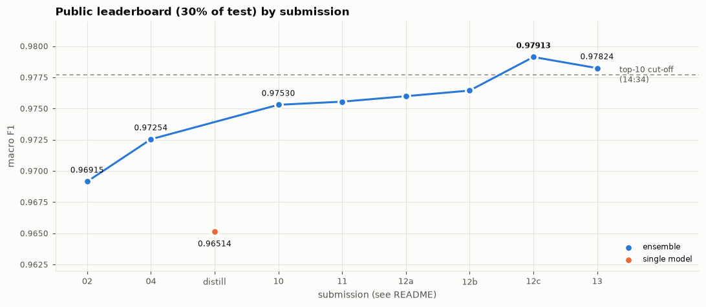
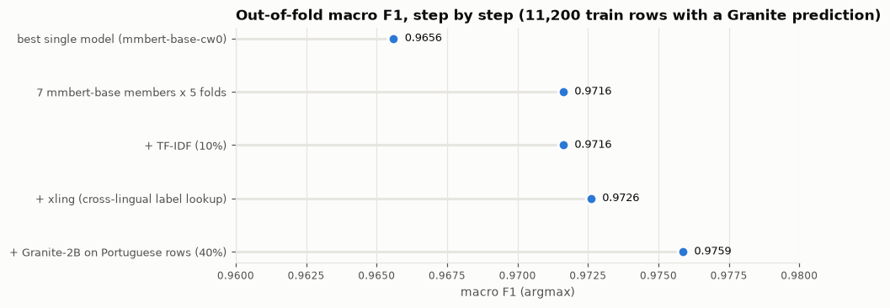
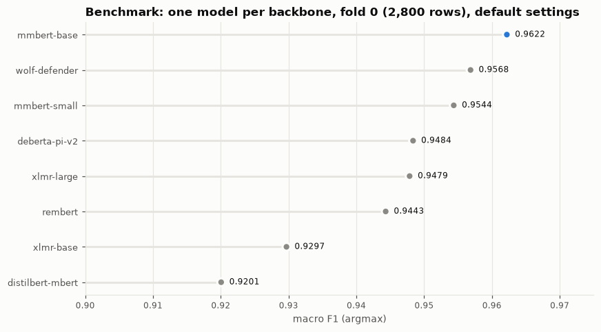
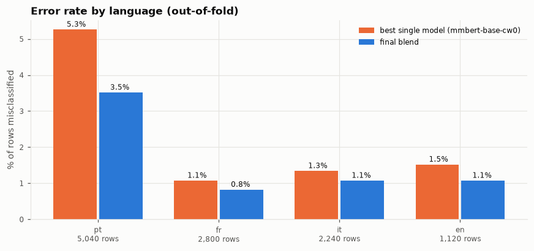
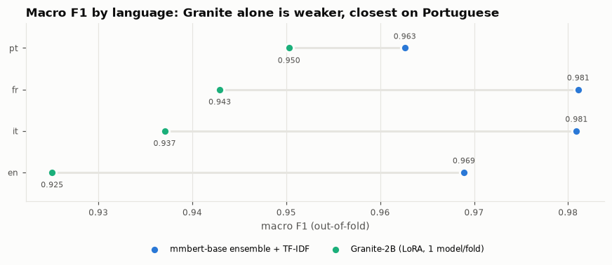

# RMIT Hackathon 2026 · Challenge 1 — Team GenData

[](https://github.com/BennedictQuanTon/Team-GenData-RMIT-Hackathon-2026/actions/workflows/ci.yml)

Phân loại prompt tấn công LLM đa ngôn ngữ (Bồ Đào Nha, Pháp, Ý, Anh) thành `BENIGN` / `JAILBREAK` / `PROMPT_INJECTION`
bằng mmBERT-base fine-tune + Granite-3.3-2B QLoRA.

| | |
|---|---|
| **Private LB (xếp hạng cuối)** | **0.98241** macro F1 · **hạng 6 cơ sở RMIT SGS · hạng 18 toàn khu vực** |
| Public LB tốt nhất | 0.97913 |
| 1 model duy nhất (mmBERT-base distill) | 0.97226 private · 0.96514 public |
| Mô hình | 60+ lần fine-tune trên 9 backbone: 35 mmBERT-base CV + 8 model 100% dữ liệu + Granite-2B 4-bit LoRA |
| Hạ tầng | Kaggle 2×T4 (tối đa 2 phiên/tài khoản), 21/10 20:00 → 22/10 17:45 |



**Bài học lớn nhất:** bản **10** có public chỉ 0.97530 nhưng **private cao nhất (0.98241)**, cao hơn bản 12c (public 0.97913 →
private 0.98111). CV đã báo trước điều này: hai bản có OOF gần như bằng nhau (~0.975), và bước "+2 model 100% dữ liệu" của 12c
chỉ đổi 12/6.000 nhãn. Mức +0.0036 trên public (≈4 dòng được chấm) phần lớn là may. **Tin CV 14.000 dòng hơn public 1.800 dòng.**



---

## 1. Cuộc thi

**RMIT GenAI & Cybersecurity Hackathon 2026** — *Security × Generative AI × Low-Resource Languages* (22–23/10/2026, Australia,
Việt Nam, Malaysia). Challenge 1 chạy trên Kaggle: [rmit-hackathon-2026](https://www.kaggle.com/competitions/rmit-hackathon-2026).

Vai trò **AI Protector**: đọc một prompt gửi tới LLM và quyết định nó là

| nhãn | ý nghĩa | train |
|---|---|---|
| `BENIGN` | yêu cầu bình thường | 62% |
| `JAILBREAK` | thuyết phục model bỏ luật an toàn (nhập vai, "DAN", kịch bản giả tưởng…) | 31% |
| `PROMPT_INJECTION` | chiếm quyền chỉ dẫn ("ignore previous instructions", lộ system prompt…) | 7% |

- **Dữ liệu:** `train.csv` 14.000 dòng, `test.csv` 6.000 dòng; `language` ∈ {pt 45%, fr 25%, it 20%, en 10%}, mỗi ngôn ngữ cùng tỉ lệ nhãn
  62/31/7. Văn bản 10–18.550 ký tự. Giấy phép CC BY-NC-SA 4.0 (không commit dữ liệu).
- **Macro F1:** trung bình F1 của 3 lớp không trọng số → lớp hiếm `PROMPT_INJECTION` nặng ngang `BENIGN`.
- **Luật:** fine-tune model trong danh sách được duyệt (XLM-R base/large, mmBERT small/base, DistilBERT multilingual, RemBERT,
  DeBERTa-v3 PI-v2, Wolf Defender, Granite 3.3 2B, Mistral 7B v0.3); 6 lượt nộp/ngày; notebook tên `RMIT_SGS_GenData_C1`.
  Repo giữ cả hai đường: ensemble (điểm cao nhất) và 1 model duy nhất (`configs/single/`).

---

## 2. Giải pháp

```
                    ┌─────────────────────────────── 5-fold CV (cùng split, nhóm theo văn bản trùng) ──────────────────────────┐
 train.csv ──►      │ 7 × mmBERT-base fine-tune (gốc, cw0, lang, ls, seed 7, seed 21, lang+seed 7)  → 35 model, OOF + test │
                    │ TF-IDF + logistic regression (CPU)                                             →  5 model           │
                    │ Granite-3.3-2B 4-bit + LoRA, fold 0/1/3/4 (fold 2 hỏng → loại)                 →  4 model           │
                    └──────────────────────────────────────────────────────────────────────────────────────────────────────────┘
 + 2 × mmBERT-base train trên 100% train (chỉ dùng cho test)

 xác suất = 0.9 · mean(mmBERT) + 0.1 · TF-IDF
          → câu tiếng Bồ Đào Nha: 0.6 · trên + 0.4 · Granite
          → xling: câu có bản dịch trong train (cosine ≥ 0.85, mmBERT gốc) lấy nhãn của bản dịch
          → argmax
```

**Công thức train chung (encoder):** max_len 512 = 384 token đầu + 128 token cuối · AdamW, lr 3e-5, 3 epoch, warmup 10% · cross-entropy
có trọng số lớp √(1/tần suất) · fp16 · đóng băng embedding (mmBERT/XLM-R: ~½ tham số) · 4 lần đánh giá/epoch trên fold + 512 dòng train
(phát hiện overfit). **LLM:** 4-bit NF4 + LoRA r16/α32 mọi lớp tuyến tính, `paged_adamw_8bit`, lr 1e-4, 1 epoch.

**Mọi quyết định được chọn trên out-of-fold (OOF)**, không theo public LB: 14.000 dòng có nhãn so với ~1.800 dòng public.
CV khớp LB trong suốt cuộc thi (bản 04: fold 0 0.9708 → public 0.97254; bản 10–11: OOF ~0.975 → public 0.9753–0.9756), và private
(70% test) còn cao hơn public ~0.007 cho cả 3 bản được chọn.



---

## 3. Insight

### 3.1 Backbone: mmBERT-base thắng rõ

Benchmark 8 encoder trên cùng fold 0 (2.800 dòng), cấu hình mặc định:



mmBERT-base (ModernBERT đa ngôn ngữ) vừa tốt nhất vừa nhanh (~12 phút/fold trên 1 T4). XLM-R-large cần 1 GPU + gradient checkpointing
mà vẫn thua. Chỉnh siêu tham số (label smoothing, 2 epoch, thêm tag ngôn ngữ, bỏ trọng số lớp) **không** biến thể nào thắng đơn lẻ
→ dùng chúng làm thành viên ensemble.

### 3.2 Gần hết lỗi là tiếng Bồ Đào Nha, BENIGN ↔ JAILBREAK



- 1 model: pt **5,4%** lỗi (340/429 lỗi toàn bộ), fr/it/en ~1,1%. 328/340 lỗi pt là nhầm `BENIGN` ↔ `JAILBREAK`, văn bản 300–3000
  ký tự, và model **rất tự tin** (trung vị p = 0,99).
- Mẫu lỗi có dạng nhập vai / kịch bản giả tưởng / "chuyên gia an ninh", nhìn giống kiểu adversarial harmful vs benign của WildJailbreak:
  hai loại viết cùng phong cách, nhãn phụ thuộc ý định thật sự bên dưới. Đây là việc cần hiểu ngữ nghĩa → lý do dùng LLM.
- Không phải do cắt văn bản: chỉ 35 câu pt trong test dài hơn 2.000 ký tự.

### 3.3 Granite-2B: yếu hơn khi đứng một mình, nhưng bổ sung đúng chỗ



Granite kém ensemble ở mọi ngôn ngữ, gần nhất ở pt. Nhưng lỗi của nó **khác** lỗi của mmBERT: trộn 40% Granite **chỉ cho câu pt**
nâng OOF từ 0.9726 → **0.9759** (11.200 dòng); trộn cho cả ngôn ngữ khác làm giảm. Public: 0.97254 → **0.97530**.

**LLM fine-tune không ổn định:** 3/8 lần train Granite bị hỏng (fold 2 seed 42: F1 0.37 + xác suất NaN; fold 2 seed 7: 0.63; fold 1 seed 7:
0.68). Quy tắc: **fold nào OOF F1 < 0.9 thì loại** (`tools/build_final.py` làm tự động).

### 3.4 Những gì giúp được

| thay đổi | bằng chứng |
|---|---|
| **Ghép nhiều run cùng backbone** (biến thể + seed) | OOF (14k dòng) 1 model 0.9667 → 5 thành viên 0.9718 → 7 thành viên 0.9724 |
| **argmax thay cho offset lớp tinh chỉnh** | offset nhìn đẹp in-sample nhưng thua khi fit ngoài fold: OOF 0.9649 argmax vs 0.9631 cross-fit |
| **xling** (tra nhãn bản dịch) | +0.001 OOF; ngưỡng 0.85 (0.78 chọn trên fold 0 hoà vốn trên 14k dòng: sửa 10, làm sai 10) |
| **Granite cho pt** | +0.0033 OOF, +0.0028 public |
| Model train 100% dữ liệu cho test | public +0.0036 (bản 12c) nhưng private **thấp hơn** bản 10 (0.98111 < 0.98241) → không phải cải thiện thật |

### 3.5 Những gì không giúp (đều đo ngoài fold)

| thử | kết quả |
|---|---|
| Thêm encoder khác (wolf, deberta, xlmr, distilbert, mmbert-small) vào ensemble | giảm |
| TF-IDF trọng số > 0,1 khi ensemble đã mạnh | không tăng, 0,6 → 0.9637 |
| Offset riêng cho từng ngôn ngữ / chỉ đẩy lớp PI (cross-fit) | 0.9639 < 0.9649 argmax / 0.9741 < 0.9749 argmax |
| Stacking (logistic regression trên log-prob, theo ngôn ngữ) | 0.9737 / 0.9715 < 0.9745 trọng số tay |
| Granite chỉ khi ensemble không chắc / chỉ cho quyết định B vs J | 0.9761 / 0.9756 ≈ 0.9759 |
| Bỏ phiếu giữa các bản dịch trong test (dùng dự đoán) | 0.9734 → 0.9736 (nhiễu) |
| kNN cùng ngôn ngữ (TF-IDF) | không sửa được gì: ở các câu gần giống nhau model vốn đúng |
| Trung bình nhân / bỏ phiếu thay trung bình cộng | 0.9721 / 0.9723 vs 0.9724 |

### 3.6 Bài học vận hành

- **Đừng tin `Trainer.predict` của transformers 5:** trả dự đoán sai thứ tự (XLM-R-large: F1 0.94 trong lúc train, 0.35 OOF) → tự viết
  vòng suy luận + chặn khi điểm cuối lệch điểm trong train > 0.05.
- **Split phải giống hệt giữa máy và Kaggle:** `make_folds` dùng `numpy.RandomState`, kiểm tra bằng dấu vân tay (`10a79e50dde8`).
- **Phiên Kaggle có thể treo vô hạn** (một job kẹt giữ cả phiên, mất output mọi job): runner tự kill job quá 170 phút; log đọc trực
  tiếp được qua API stream (`kernels_logs_stream`) dù `kaggle kernels logs` trả rỗng khi đang chạy.
- **Giới hạn 2 phiên/tài khoản (cả CPU):** chạy 2 job/phiên (mỗi T4 một job) và nhờ tài khoản đồng đội chạy notebook dựng sẵn
  (`kaggle/ready/`).
- Mỗi bản nộp chỉ khác vài chục nhãn → public (1.800 dòng, ±0,004) không phân biệt được; chọn theo OOF 11–14k dòng.
  Private xác nhận: bản public cao nhất (12c) không phải bản private cao nhất (10).

---

## 4. Tái lập

```bash
make setup                     # uv sync + pre-commit
make data                      # tải dữ liệu cuộc thi vào data/ (cần kaggle.json)
make check                     # ruff + pytest

# train trên Kaggle: mỗi notebook chạy 2 job song song (1 job / T4), tự kill job treo
uv run python tools/build_kernel.py bench configs/mmbert-base.yaml@0,1,2 configs/mmbert-base.yaml@3,4 --tag my-run
kaggle kernels push -p kaggle/build/rmit-sgs-gendata-my-run-c1 -t 3600
kaggle kernels output longquanton/rmit-sgs-gendata-my-run-c1 -p outputs/rmit-sgs-gendata-my-run-c1

uv run rmitguard xling --out artifacts/xling   # láng giềng xuyên ngôn ngữ (mmBERT gốc, ~3 phút trên T4)
make final                     # ghép → submissions/RMIT_SGS_GenData_C1.csv (khớp từng byte với bản public 0.97913)
make experiments figures       # experiments/ + docs/figures/
```

Cấu hình từng thành viên: `configs/*.yaml` (benchmark), `configs/sweep/` (biến thể, seed, Granite), `configs/single/`
(train 100% dữ liệu, distill). Notebook dựng sẵn cho đồng đội: `kaggle/ready/` (hướng dẫn ở ô đầu).

---

## 5. Cấu trúc repo

```
src/rmitguard/        package: config, data (split), models (transformer / LLM / TF-IDF), runner (CV + artifacts),
                      ensemble (trọng số theo ngôn ngữ), xling, postprocess, charts, cli
tools/                build_kernel (notebook Kaggle) · build_final (bản nộp) · select_final (chấm thành viên trên OOF)
                      collect_experiments · make_readme_figures · push_when_free / fetch_when_done (hàng chờ phiên Kaggle)
configs/              mỗi file một thí nghiệm (model phải thuộc danh sách được duyệt, kiểm tra khi load)
experiments/          mọi run đã chạy: biểu đồ sức khoẻ train, confusion, lỗi theo ngôn ngữ/độ dài, so sánh (README riêng)
docs/                 PROBLEM.md (đề bài) · WORKFLOW.md (quy trình) · figures/ (biểu đồ README)
kaggle/ready/         notebook cho thành viên chạy bằng tài khoản riêng
tests/                unit + end-to-end trên dữ liệu giả
Plan.md               nhật ký chiến lược theo giờ (tiếng Việt), mọi số liệu và quyết định
```

Không commit: dữ liệu cuộc thi, `*.npy`, trọng số, `kaggle.json`, `outputs/`, `artifacts/`, `submissions/` (`.gitignore` + CI kiểm tra).

---

## 6. Bản nộp

| # | nội dung | public | private |
|---|---|---|---|
| 02 | 5 mmBERT-base (fold 0) + offset tinh chỉnh | 0.96915 | |
| 04 | + xling, argmax | 0.97254 | |
| distill ✓ | **1 mmBERT-base**, distill từ ensemble, 100% train | 0.96514 | 0.97226 |
| **10 ✓** | **7 mmBERT ×5 fold + TF-IDF + Granite (pt, 2 fold) + xling** | 0.97530 | **0.98241** |
| 11 | Granite 4 fold | 0.97555 | |
| 12a | Granite pt 0,45 | 0.97599 | |
| 12b | Granite chỉ khi ensemble không chắc | 0.97644 | |
| 12c ✓ | + 2 mmBERT-base train 100% dữ liệu → `RMIT_SGS_GenData_C1.csv` | **0.97913** | 0.98111 |
| 13 | + 6 model 100% dữ liệu, Granite seed 2 | 0.97824 | |

✓ = 3 bản chọn để chấm cuối (Kaggle lấy bản private tốt nhất). Private chỉ công bố cho bản được chọn.

---

Team **GenData** · RMIT SGS · RMIT GenAI & Cybersecurity Hackathon 2026.
Challenge 2 (Tide UNLOCKED) của đội: [RMIT_SGS_GenData_C2](https://github.com/BennedictQuanTon/RMIT_SGS_GenData_C2) — *Unfound*.
