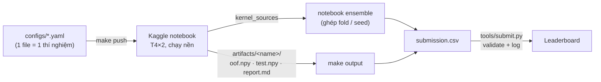

# Workflow — từ ý tưởng đến submission



## 0. Cài đặt (một lần, ~3 phút)

```bash
git clone https://github.com/BennedictQuanTon/Team-GenData-RMIT-Hackathon-2026.git && cd Team-GenData-RMIT-Hackathon-2026
curl -LsSf https://astral.sh/uv/install.sh | sh     # nếu chưa có uv
make setup                                           # .venv (Python 3.11) + pre-commit hooks
```

Kaggle API: Kaggle → Settings → **Create New Token** → lưu vào `~/.kaggle/kaggle.json`, rồi `chmod 600 ~/.kaggle/kaggle.json`.
**Phải Join competition trên web trước**, nếu không mọi lệnh tải data / nộp bài trả về 403.

## 1. Chạy local (CPU)

```bash
make data         # tải data vào data/ (gitignored)
make eda          # reports/eda.md: label × language, độ dài, trùng lặp, train↔test trùng
make baseline     # TF-IDF 5-fold: kiểm tra pipeline + sàn CV
make check        # lint + test (giống CI)
```

Mọi lệnh đều qua CLI `rmitguard` (`uv run rmitguard --help`): `eda`, `train`, `ensemble`, `validate`.
Smoke test nhanh trên máy bất kỳ: `uv run rmitguard train configs/tfidf.yaml --limit 500`.

## 2. Chạy thí nghiệm trên Kaggle GPU

```bash
make push CONFIG=configs/xlmr-large.yaml            # đủ 5 fold
make push CONFIG=configs/xlmr-large.yaml FOLDS=0    # chỉ fold 0 (sàng lọc nhanh)
make status KERNEL=<username>/rmit-sgs-gendata-xlmr-large-f0-c1
make output KERNEL=<username>/rmit-sgs-gendata-xlmr-large-f0-c1   # → outputs/<slug>/artifacts/<name>/report.md
```

`make push` build notebook từ code **đúng commit hiện tại** (`tools/build_kernel.py`): mỗi module là một cell `%%writefile`,
có sẵn tên model ở đầu notebook, `kernel-metadata.json` gắn competition + model được duyệt + GPU T4. Không cần upload dataset.

Tên notebook tự sinh đúng luật: thí nghiệm = `RMIT_SGS_GenData-<exp>_C1`, bản chính thức (`--final`) = `RMIT_SGS_GenData_C1`.

**Chia fold cho nhiều người:** cùng config (cùng `seed`, `n_folds`) ⇒ cùng split (`split` fingerprint trong `report.md`).
Người 1 chạy `FOLDS=0,1`, người 2 `FOLDS=2,3,4` → ghép bằng ensemble. Code tự kiểm tra fingerprint, lệch là báo lỗi.

## 3. Ghép (ensemble) và nộp

**Cách A — trên Kaggle (khuyên dùng, nộp từ notebook):**
mỗi người vào notebook của mình → *Share* → thêm các thành viên làm collaborator (để notebook của nhau dùng được làm input), rồi:

```bash
make push-ensemble SOURCES=userA/rmit-sgs-gendata-xlmr-large-f01-c1,userB/rmit-sgs-gendata-xlmr-large-f234-c1
# bản chính thức:
uv run python tools/build_kernel.py ensemble --sources userA/...,userB/... --final && uv run kaggle kernels push -p kaggle/build/rmit-sgs-gendata-c1
```

**Cách B — local:** `make output KERNEL=...` cho từng run, rồi `make ensemble SOURCES="outputs/a outputs/b"` → `artifacts/ensemble/`.

**Nộp bài (6 lượt/ngày):**

```bash
make submit-dry KERNEL=<user>/rmit-sgs-gendata-c1 MSG="xlmr-large 5f cv=0.97xx"     # validate + đếm lượt hôm nay
make submit     KERNEL=<user>/rmit-sgs-gendata-c1 VERSION=3 MSG="xlmr-large 5f cv=0.97xx"
```

Sau khi có điểm public, điền cột `public_lb` trong `experiments/submissions.csv` và dòng tương ứng trong `experiments/LOG.md`.

## 4. Git

- `main` được bảo vệ: làm trên nhánh `exp/<tên>` hoặc `fix/<tên>`, mở PR, CI xanh mới merge.
- Thí nghiệm mới = **file config mới** trong `configs/` (đừng sửa config người khác đang chạy).
- Một ý tưởng = một issue (template *Experiment*) → ghi kết quả → quyết định keep / drop / submit.
- Không bao giờ commit: data, `*.npy`, trọng số model, `kaggle.json` (pre-commit + CI chặn).

## 5. CI/CD (GitHub Actions)

| workflow | khi nào | làm gì |
|---|---|---|
| `CI` | mỗi push / PR | ruff lint + format · pytest (Python 3.11, 3.12) + coverage · smoke test HF Trainer thật với XLM-R tí hon (CPU) · build mọi notebook Kaggle · chặn file data/secret |
| `Kaggle — push & run notebook` | bấm tay (Actions → Run workflow) | build notebook từ commit → `kaggle kernels push` → chạy trên T4 |
| `Kaggle — submit notebook output` | bấm tay, gõ `SUBMIT` | validate + nộp output của notebook + log |

Thiết lập một lần (repo owner):
1. Settings → Secrets and variables → Actions: `KAGGLE_USERNAME`, `KAGGLE_KEY` (tài khoản dùng để chạy/nộp).
2. Settings → Environments → tạo `kaggle` → *Required reviewers* = 1 người khác ⇒ mọi lượt nộp qua CI cần người thứ hai duyệt.
3. Settings → Branches → bảo vệ `main`: require PR + status checks `lint`, `test`.

## 6. Đọc `report.md`

| dòng | ý nghĩa |
|---|---|
| macro F1 (argmax) | điểm nếu lấy lớp có xác suất cao nhất |
| macro F1 (tuned, in-sample) | sau khi chỉnh offset — hơi lạc quan |
| **macro F1 (tuned, cross-fitted)** | offset học trên các fold khác, chấm trên fold còn lại → **con số để so sánh** |
| public-LB-sized noise | khoảng dao động nếu chỉ chấm 1,800 dòng như public LB |
| Per language / Confusion | tìm chỗ yếu: ngôn ngữ nào, nhầm JAILBREAK ↔ PI hay BENIGN ↔ attack |
| Folds: `truncated`, `minutes`, `peak_vram_gb` | prompt bị cắt bao nhiêu %, thời gian, VRAM → chỉnh `max_len` / batch |
