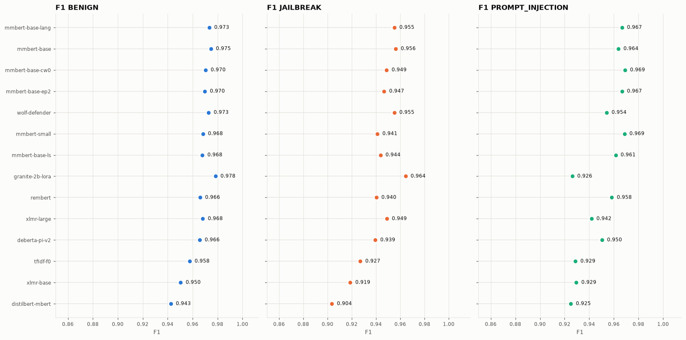
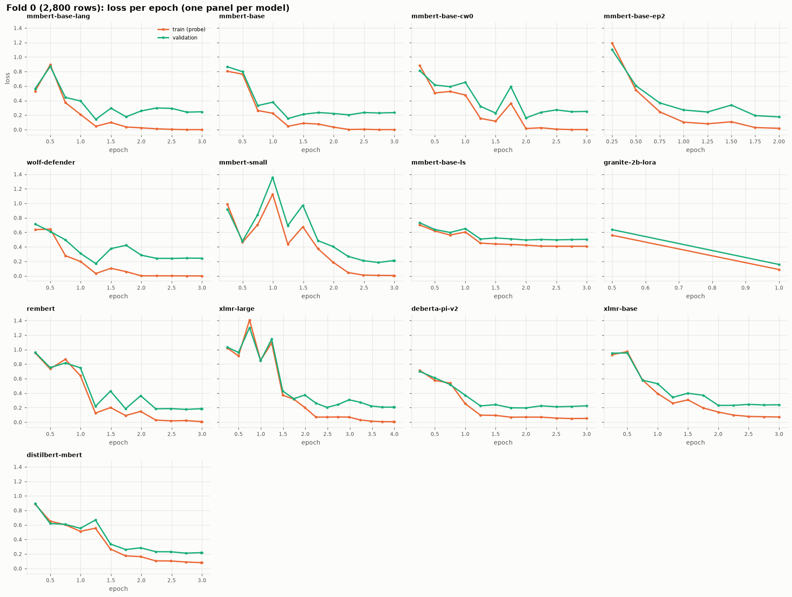
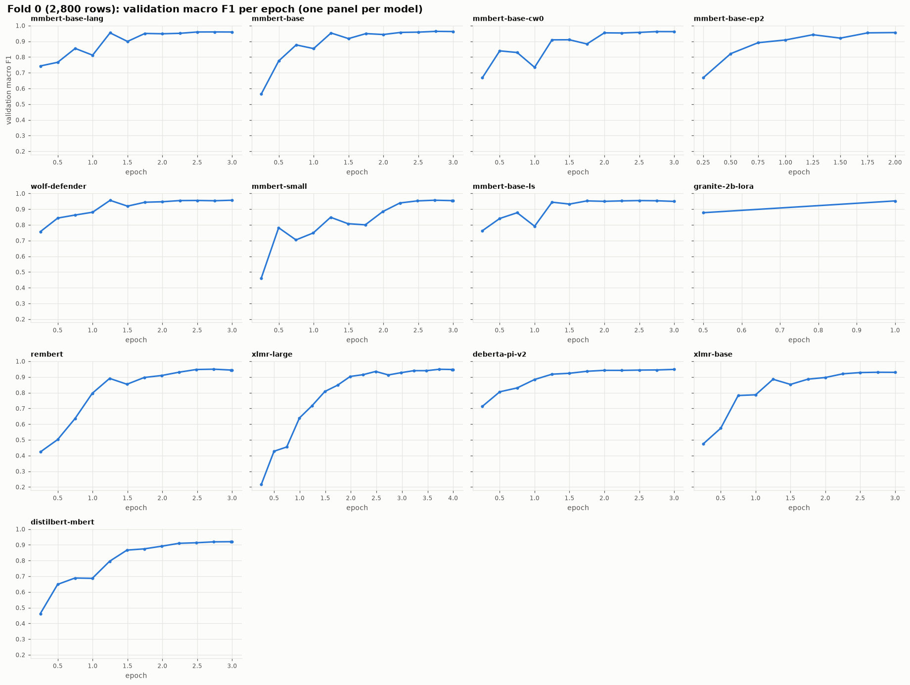

# Experiments

Generated by `tools/collect_experiments.py` — every chart below is regenerated from the run artifacts.

| folder | what |
|---|---|
| `00-eda/` | data facts: length by class, TF-IDF error heatmap, eda.md |
| `01-tfidf-baseline/` | TF-IDF + logistic regression (CPU): 5-fold, fold 0, holdout 20% |
| `02-pipeline-debug/` | first GPU runs, before the prediction-order fix (only in-training curves valid) |
| `03-bench-fold0/` | every approved encoder, fold 0, default hyper-parameters |
| `04-tune-fold0/` | variants of the two best encoders (epochs, lr, language tag, class weights) |
| `05-llm-fold0/` | Granite-2B / Mistral-7B, 4-bit + LoRA |
| `06-holdout/` | best encoder config, 20% locked holdout (private-LB estimate) |
| `summary/` | comparison charts + `summary.csv` for every fold-0 run |

## Fold-0 comparison (same 2,800 validation rows)

| run              |   macro F1 |   argmax |   F1 B |   F1 J |   F1 PI |   pt J |   en PI |   min/fold |   VRAM GB |   val−train loss |   best epoch |
|:-----------------|-----------:|---------:|-------:|-------:|--------:|-------:|--------:|-----------:|----------:|-----------------:|-------------:|
| mmbert-base-lang |     0.965  |   0.9592 | 0.9733 | 0.9551 |  0.9666 | 0.9141 |  0.9189 |    11.1125 |    7.6197 |           0.2458 |       2.75   |
| mmbert-base      |     0.9649 |   0.9622 | 0.9747 | 0.9563 |  0.9637 | 0.917  |  0.8571 |    12.1046 |    7.6197 |           0.235  |       2.75   |
| mmbert-base-cw0  |     0.9628 |   0.9616 | 0.9705 | 0.9488 |  0.9691 | 0.9025 |  0.8947 |    11.1765 |    7.6197 |           0.25   |       2.75   |
| mmbert-base-ep2  |     0.961  |   0.9557 | 0.9699 | 0.9467 |  0.9666 | 0.8932 |  0.8889 |     7.433  |    7.6197 |           0.1574 |       2      |
| wolf-defender    |     0.9607 |   0.9568 | 0.9729 | 0.9551 |  0.9541 | 0.914  |  0.8421 |    11.1395 |    7.6197 |           0.2433 |       3      |
| mmbert-small     |     0.9593 |   0.9544 | 0.9683 | 0.9411 |  0.9686 | 0.8871 |  0.8571 |     7.8466 |    8.9204 |           0.206  |       2.7343 |
| mmbert-base-ls   |     0.9577 |   0.9494 | 0.9679 | 0.9437 |  0.9614 | 0.8877 |  0.8649 |    11.0241 |    7.6197 |           0.0964 |       2.5    |
| granite-2b-lora  |     0.9563 |   0.9525 | 0.9784 | 0.9644 |  0.9262 | 0.9389 |  0.75   |    84.6502 |    3.3556 |           0.0696 |       1      |
| rembert          |     0.9549 |   0.9443 | 0.966  | 0.9403 |  0.9583 | 0.8863 |  0.8    |    46.5953 |   10.6552 |           0.1775 |       2.7343 |
| xlmr-large       |     0.953  |   0.9479 | 0.9682 | 0.9489 |  0.9418 | 0.9127 |  0.8571 |    34.842  |    7.12   |           0.2018 |       3.7286 |
| deberta-pi-v2    |     0.9518 |   0.9484 | 0.9657 | 0.9394 |  0.9504 | 0.8858 |  0.8718 |    15.7173 |   13.3998 |           0.1739 |       3      |
| tfidf-f0         |     0.9378 |   0.9354 | 0.9576 | 0.927  |  0.9288 | 0.8715 |  0.7879 |     0.2162 |    0      |         nan      |     nan      |
| xlmr-base        |     0.9329 |   0.9297 | 0.9505 | 0.9188 |  0.9295 | 0.8488 |  0.7429 |    10.3213 |    6.9518 |           0.1684 |       2.75   |
| distilbert-mbert |     0.9237 |   0.9201 | 0.9426 | 0.9036 |  0.9251 | 0.8145 |  0.7222 |     5.2356 |    5.2276 |           0.1375 |       2.9829 |

